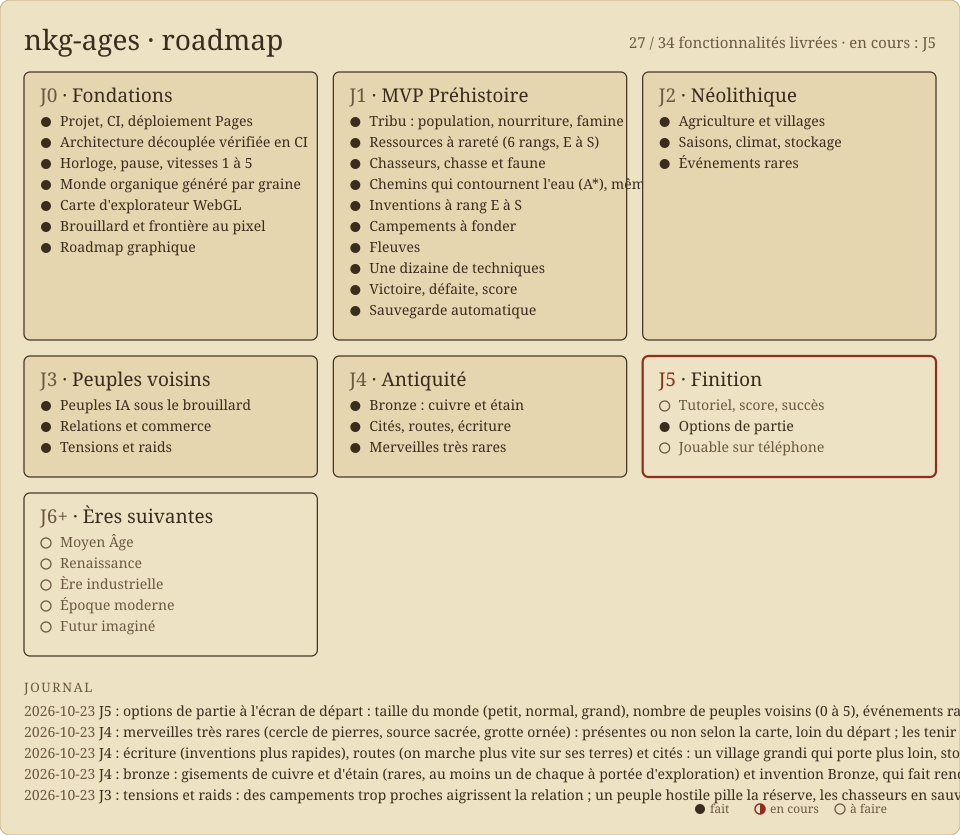

# nkg-ages

Jeu de gestion et de stratégie au long cours, dans le navigateur : on guide un peuple de la
préhistoire jusqu'au présent, puis vers un futur imaginé.

Version jouable : https://acassar.github.io/nkg-ages/ · mesure de la carte : ajouter `?bench` à l'adresse.



## Démarrer

```bash
pnpm install
pnpm dev
```

## Jouer (J0)

| Action              | Commande                                      |
| ------------------- | --------------------------------------------- |
| Pause / vitesse     | `Espace` / `1` à `5`, ou la barre du haut     |
| Choisir l'éclaireur | clic sur son pion                             |
| Envoyer l'éclaireur | clic droit sur la carte                       |
| Déplacer la carte   | glisser, `ZQSD` (`WASD` en QWERTY) ou flèches |
| Zoomer              | molette                                       |

Un tick vaut un mois de jeu ; les vitesses 1 à 5 jouent 1, 3, 8, 24 et 72 ticks par seconde.

## Architecture

Le détail et ses raisons sont dans [docs/architecture.md](docs/architecture.md). En bref, chaque
couche ne connaît que celle du dessous, et la CI refuse tout import qui franchit une frontière :

| Dossier       | Rôle                                                                      |
| ------------- | ------------------------------------------------------------------------- |
| `src/engine/` | Moteur en TypeScript pur : état, règles, monde, contenu en données        |
| `src/views/`  | Sélecteurs : état du moteur vers modèles de vue (`types.ts` est public)   |
| `src/host/`   | Fait tourner le moteur en temps réel (Web Worker), publie les vues        |
| `src/client/` | `GameClient` : seul point d'entrée de l'interface (Worker ou en mémoire)  |
| `src/render/` | Rendu de la carte derrière l'interface `MapRenderer` (WebGL2 aujourd'hui) |
| `src/ui/`     | Interface Vue : envoie des commandes, affiche des vues                    |

## Scripts

| Script              | Rôle                                                                  |
| ------------------- | --------------------------------------------------------------------- |
| `pnpm dev`          | serveur de développement                                              |
| `pnpm build`        | vérification des types + build                                        |
| `pnpm test`         | tests unitaires, de propriétés, de scénarios et d'architecture        |
| `pnpm archi`        | vérifie les frontières entre couches                                  |
| `pnpm lint`         | ESLint                                                                |
| `pnpm format:check` | Prettier                                                              |
| `pnpm bench`        | coût du moteur (génération du monde, ms par tick), avec budget        |
| `pnpm e2e`          | test de fumée dans Chromium, bureau et téléphone (après `pnpm build`) |
| `pnpm bench:map`    | mesure de la carte dans Chromium (après `pnpm build`)                 |
| `pnpm sonde`        | équilibrage : un robot joue 40 parties, années de chaque étape        |
| `pnpm roadmap`      | régénère la roadmap graphique depuis `roadmap.json`                   |

## Roadmap

`roadmap.json` est la source unique. Chaque PR met à jour l'état de ses fonctionnalités et le
journal, puis lance `pnpm roadmap` ; un test vérifie que les images sont à jour. L'image est
aussi servie avec le jeu : `roadmap.svg`.
